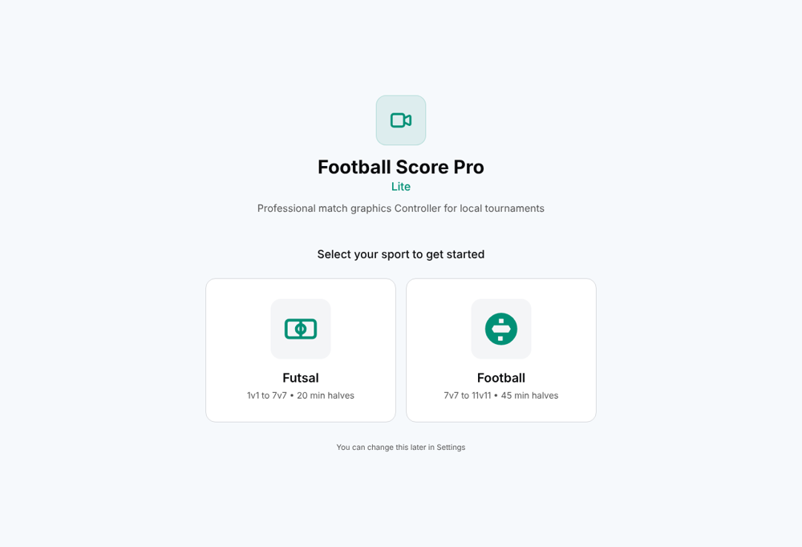

# Football Score Lite

A desktop app for putting live match graphics on a football or futsal
stream. The operator runs the match from one window (score, clock, goals,
cards, substitutions) and the graphics render in a separate page that OBS
captures as a browser source.

I built it at FutureFrame (Lalitpur, Nepal) as the lighter companion to
[Football Score Pro](https://github.com/imsudip45/fsp). It is a Next.js app
packaged with Electron.



## What it does

- **Setup**: tournaments, fixtures, teams and lineups (with formations),
  officials, and an asset library for logos. Teams and officials can be
  imported from CSV (samples in `public/sample-data/`).
- **Live control**: match clock, score, goals, cards, substitutions and
  match stats, with keyboard shortcuts for the common actions.
- **Graphics**: score bug, lower thirds, breaking-news banner, goal/card
  overlays, substitution overlay, starting lineups, versus screen, match
  officials and a stats lower third. Colours, patterns and text styles can
  be customised and exported.
- **Commentator view**: a read-only page with lineups, events and stats that
  commentators can open on another device on the same network.
- **Local storage**: matches and settings are kept in IndexedDB (Dexie);
  uploaded images are saved under Electron's user-data folder.

## How it fits together

```
Operator window (Next.js UI in Electron)
        │  state updates
        ▼
WebSocket server (electron/server.ts, port 8080)
        │  broadcasts state
        ├──► /renderer        → OBS browser source
        ├──► renderer windows → preview on the operator machine
        └──► /commentator     → commentators' devices
```

In the packaged app Electron also serves the static build on port 3000 and
user-uploaded images on port 3002, so OBS or another machine can load them.
These servers listen on all network interfaces so other devices on the
production network can connect; run the app on a trusted network.

## Run it

Node.js 20 or newer and pnpm.

```bash
pnpm install
pnpm dev:electron        # Next.js dev server + Electron
```

Or run the pieces separately: `pnpm dev`, then `pnpm electron:start`.

For OBS, add a browser source pointing at `http://localhost:3000/renderer`
(1920×1080).

### Build installers

```bash
pnpm dist:win            # or dist:mac / dist:linux
```

## Notes

- The broadcast designs used a licensed display font, Snasm W05, which is
  not included. Graphics fall back to Bebas Neue; to use Snasm, put
  `Snasm-W05-Regular.ttf` in `public/`.
- Built mostly in late 2025. After I left the project I updated the
  dependencies (Electron 45, Next.js 16.4) and fixed loading of uploaded
  images in Electron. See the commit history.

## Licence

MIT, see [LICENSE](LICENSE).
